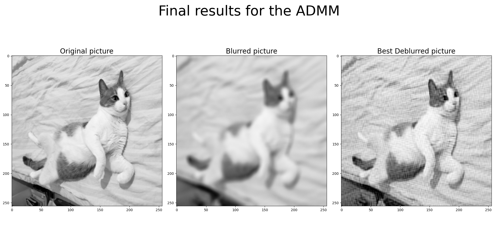

# Deblurring using the Alternating Direction Method of Multipliers (ADMM)

This is just some old code I found on my Google Drive, and I would like to store it in a place where I do not risk deleting it by mistake.

  
   

